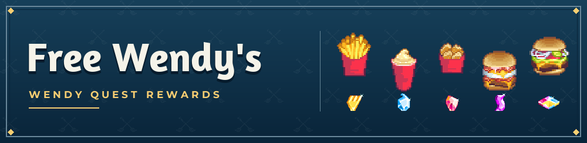

# Free Wendy's



- **Play** at [wendys.vracto.xyz](https://wendys.vracto.xyz).
- **Pick** Crispy Fries, Frosty, Spicy Nuggets, Breakfast Sandwich, or Beef Single.
- **Redeem** an available code in the Wendy's app. Claimed codes are saved in your browser.

The pixel art and visual style are inspired by Wendy Quest.

## Run locally

Requires Node.js 22.13 or later.

```sh
npm ci
npm run dev
```

Open the URL printed in your terminal.

## Reward flow

- Selection indices 0–4 map to upstream coupon types 1–5: fries, Frosty, spicy nuggets, breakfast, and beef.
- A server-created upstream session is reused through a 30-day HttpOnly, SameSite cookie (Secure on HTTPS).
- Promotion status is checked before retrieval; unavailable or ended promotions do not request coupons.
- Successful reward codes are saved in the visitor's browser so they can reopen them.
- Exact menu items, sizes, eligibility, expiration, stock, and final redemption are controlled by the upstream promotion.
- The MD5 request header reproduces the game protocol. The upstream server is responsible for authentication and eligibility.

The site ships its fonts locally and runs without third-party analytics.

## Verify changes

```sh
npm test
npx tsc --noEmit
npm run build
```

The tests use mock responses, so they run without claiming real coupons.
